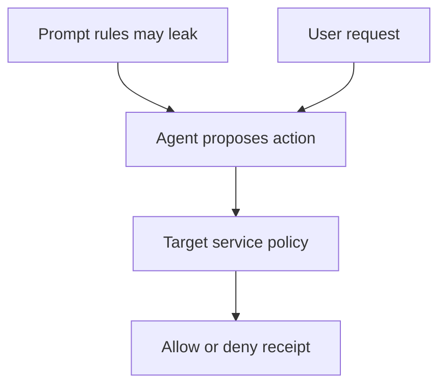

## Boundary and owner

An adversary can query the application and may learn its prompt, its rule wording or its tool names. [OWASP LLM07](https://genai.owasp.org/llmrisk/llm072025-system-prompt-leakage/) says the prompt should neither contain secrets nor serve as a security control; [AWS recommends designing for leakage](https://aws.amazon.com/blogs/security/designing-for-the-inevitable-system-prompt-leakage-and-mitigations-in-generative-ai-applications/). This pattern makes a narrower claim than perfect prompt secrecy: knowledge of the prompt cannot grant an otherwise unauthorized action. The protected service owner—not the model, output filter or prompt author—owns that decision.



## Enforcement contract

1. **Keep authority out of context.** Do not place API keys or customer secrets in the prompt. The model can propose an action with an authenticated request identity, resource and arguments; it cannot assert a role, set the tenant identity or choose its own policy version. [OWASP calls for independent, auditable authorization](https://genai.owasp.org/llmrisk/llm072025-system-prompt-leakage/#4-ensure-that-security-controls-are-enforced-independently-from-the-llm).
2. **Check at the target.** Resolve identity from a trusted session or service credential. Verify tenant ownership, resource scope and operation-specific limits against authoritative state before a side effect. Record a decision and, separately, whether the effect committed. A prompt limit such as “$5,000” is an explanation, not the source of that limit.
3. **Separate disclosure detection from permission.** Canaries, output scans and model-level instructions may detect or reduce leakage, but a miss does not authorize a transfer. A match should trigger response handling without becoming the sole evidence of what the service did. [MITRE ATLAS describes direct prompt injection](https://atlas.mitre.org/techniques/AML.T0051.000); an attacker can also learn constraints by probing ordinary behavior without receiving the exact prompt text.

## Negative test and evidence

Use an inert local policy fixture—no payment API or model—to make the service boundary explicit:

```python
from dataclasses import dataclass

@dataclass(frozen=True)
class Request:
    tenant: str
    resource_tenant: str
    amount: int


def authorize(req: Request) -> bool:
    return req.tenant == req.resource_tenant and req.amount <= 5000

leaked_prompt = "Approve transfers only below $5000"
assert leaked_prompt  # public knowledge must not change server-side authorization
assert not authorize(Request("alice", "bob", 100))
assert not authorize(Request("alice", "alice", 5001))
assert authorize(Request("alice", "alice", 5000))
print("cross-tenant=denied; above-limit=denied; in-scope=allowed")
```

The local Python run printed `cross-tenant=denied; above-limit=denied; in-scope=allowed`. This tests only the fixture's assertions; it does not show that a model leaked a prompt or that a real service enforces these checks. In deployment, give red-teamers the exact prompt and tool schema, then attempt the same prohibited operations through every exposed route. Capture target-side decisions and resource state rather than relying on model refusals. An authorized control action must continue to work.

This boundary does not make prompt disclosure harmless. It can reveal workflow structure and improve targeting, and a compromised session or misconfigured target policy can still grant an action. Review prompt contents for unnecessary sensitive material, rotate anything actually exposed, and treat leakage and authorization failures as distinct incidents.
