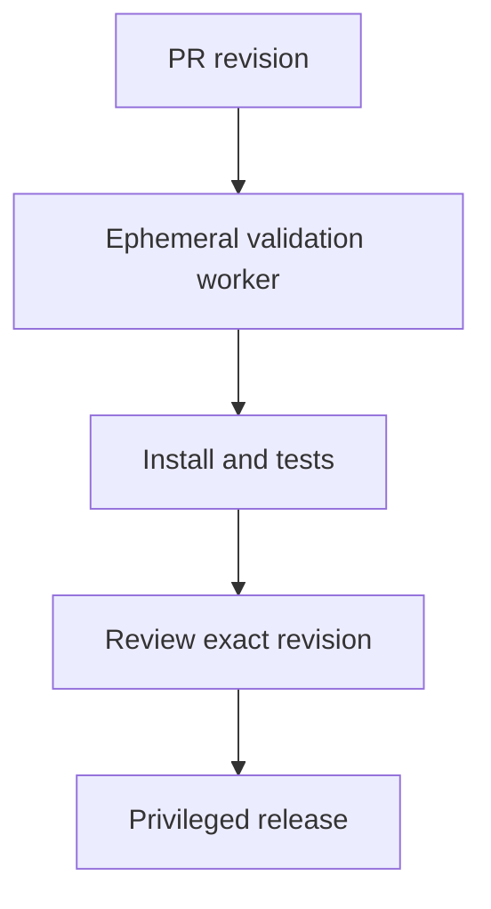

## Boundary and owner

An adversary who controls an unreviewed branch or a package resolved into its lockfile may gain execution in the install/build worker, even if the code reviewer only intended to inspect a diff. [npm's documented `ci` lifecycle](https://docs.npmjs.com/cli/v11/using-npm/scripts/#life-cycle-operation-order) includes install hooks; [lockfile consistency checks](https://docs.npmjs.com/cli/v11/commands/npm-ci/#description) do not make those hooks inert. The CI owner, not the coding agent, owns the worker's credentials, egress, cache and promotion path. This is a general design pattern, not an assertion that the Brief repository or a named agent has been exploited.

## Enforcement contract

- **Before checkout or install:** choose an ephemeral worker with read-only checkout identity and no production secrets or deployment capability. Control outbound network access independently of script text. Do not restore writable caches shared with privileged jobs. [GitHub's secure-use guidance](https://docs.github.com/en/actions/reference/security/secure-use#mitigating-the-risks-of-untrusted-code-checkout) warns about untrusted checkout under privileged triggers and cache sharing.
- **At install:** decide explicitly whether lifecycle scripts are necessary. `npm ci --ignore-scripts` suppresses automatic lifecycle scripts but is not a sandbox for later explicit `npm run` commands. If hooks are needed, execute them only in the restricted worker and examine manifest/lockfile changes. A script-free install that breaks native dependencies is not a passing validation; give unavoidable hooks a similarly restricted execution path.
- **At promotion:** require checks and review against the exact commit and build artifact. A privileged job should not fetch a PR head or execute PR scripts just because an unprivileged job emitted a green status or uploaded an artifact. Scope credentials to the release job. [GitHub's secret documentation](https://docs.github.com/en/actions/how-tos/write-workflows/choose-what-workflows-do/use-secrets#using-secrets-in-a-workflow) distinguishes fork-triggered secret withholding from other workflow contexts; never infer the same protection for every branch or trigger.

## Negative test and evidence

In an isolated PR, add the [post's inert marker hook](/the-install-step-ran-the-pull-request/) and run the actual PR workflow. Record the workflow trigger, checkout SHA, hook execution, worker identity, granted token permissions, blocked test-only egress and release job provenance; do **not** log live secrets. Try a same-repository branch and a dependency hook as well as a fork. A passing design permits the hook only in the constrained worker, denies its access to release authority and test-only egress, and rejects promotion if a later job cannot bind the artifact to the reviewed SHA. Run a legitimate build requiring a native hook too, so the boundary is usable.

The restricted worker can still fabricate its own tests or artifact. A human reviewer may approve malicious code. Artifact verification and release authorization reduce the promotion risk; they do not turn an untrusted test environment into trusted evidence by themselves. If the validation worker has broad network access, model credentials or a shared cache that a privileged job will reuse, the claimed quarantine is incomplete.
