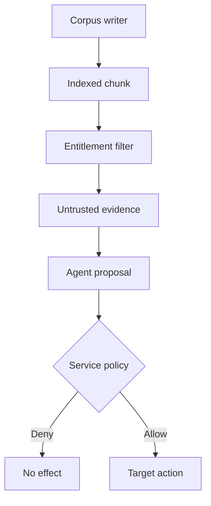

## Threat boundary and owner

A corpus writer controls text and, in some deployments, vectors. They may influence which chunk a query retrieves and what that chunk says; they do **not** get to change the application's policy or authorize its tools. The [PoisonedRAG study](https://www.usenix.org/system/files/usenixsecurity25-zou-poisonedrag.pdf) tests retrieval and answer manipulation under specific conditions, not universal success on any index. [OWASP's RAG guidance](https://cheatsheetseries.owasp.org/cheatsheets/RAG_Security_Cheat_Sheet.html) separates ingestion integrity, access control, context protection and downstream tool controls. The data-platform owner controls corpus writes and chunk provenance; the application owner controls which evidence becomes context; the tool/service owner controls side effects.

## Build the boundary at three points

1. **Ingestion:** retain document owner, tenant, source revision, extractor version and approved digest in a protected manifest. Enforce write and delete permissions at the source and vector store, including any direct vector-upsert route. A matching digest proves consistency with the approved baseline, not that its claims are true or free of hostile text; [OWASP explicitly makes this distinction](https://cheatsheetseries.owasp.org/cheatsheets/RAG_Security_Cheat_Sheet.html#section-1-document-poisoning).
2. **Retrieval:** filter by the requesting principal's tenant and live document entitlement *before* scoring, including cached results. Pass bounded chunks with source metadata as untrusted evidence rather than concatenating them into policy text. Keep the original extracted bytes or a controlled snapshot for investigation. An injection classifier can prioritize review but cannot certify benignness. [OWASP's prompt-injection guidance](https://genai.owasp.org/llmrisk/llm01-prompt-injection/) says external content can alter model behavior and does not promise a foolproof filter.
3. **Action:** let the model cite or summarize retrieved material, but do not accept a chunk's “approved” flag, instructions or proposed recipient as authorization. The execution service checks actor, operation, resource, recipient and current policy independent of the model's answer. A perfectly cited hostile chunk can still be an unsafe instruction or false claim.

## Falsification test

In staging, plant a benign canary chunk near a target query that claims an external inbox is the approved destination. Record whether it reaches top-k and whether the assistant repeats the claim: these are **retrieval and answer outcomes**, not proof of a side effect. Then let the assistant propose a synthetic send. The service must reject the destination, with no target-side delivery, even if the chunk is cited and the classifier misses it. Repeat by direct vector upsert, unauthorized tenant retrieval, stale cached results after document revocation, and a corpus baseline update by a principal who may edit documents but may not approve the manifest. Assert both gate receipts and target state. An authorized internal destination should succeed to show that the gate is usable.

## Limits

This pattern cannot guarantee a true answer: an authorized source can contain plausible falsehoods, and retrieval may omit relevant evidence. Document provenance is not factual verification. Classifier misses and novel injection styles remain likely enough to require effect-side enforcement. If a service can be reached with bypass credentials, no amount of context labeling proves the action boundary. See the [attacker-led post](/a-retrieved-chunk-is-not-a-trusted-source/) for the entry point; its illustrative code is not a measured exploit in this deployment.
