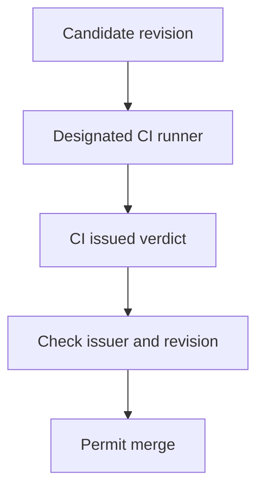

## Threat and owner

The attacker controls a credential able to submit a commit status, not the designated test runner. If a branch rule accepts any writer for a required context, the attacker can submit a `success` that looks like CI even though no trusted test ran. [GitHub's commit-status API](https://docs.github.com/en/rest/commits/statuses#create-a-commit-status) accepts a caller-supplied context and state from a writer with permission; [rulesets can select an expected GitHub App](https://docs.github.com/en/repositories/configuring-branches-and-merges-in-your-repository/managing-rulesets/available-rules-for-rulesets#require-status-checks-to-pass-before-merging). This is a conditional design threat, not a claim that a particular repository has been bypassed. The repository administrator owns required-check configuration; the CI owner owns the runner identity and the meaning of its verdict.

## Enforcement contract

- Configure each consequential required context with an expected source rather than “any source.” Check the actual branch protection and every active ruleset; the displayed check name alone is insufficient. [GitHub notes](https://docs.github.com/en/repositories/configuring-branches-and-merges-in-your-repository/managing-protected-branches/about-protected-branches#about-branch-protection-rules) that duplicate job names across workflows can cause ambiguity.
- Prevent agent identities and PR validation jobs from setting the required verdict. Give them only necessary token permissions and keep privileged workflow definitions off unreviewed branches. [GitHub's workflow security reference](https://docs.github.com/en/actions/reference/security/secure-use#writing-workflows) recommends least privilege; its untrusted-checkout guidance warns about privileged workflow triggers.
- Accept the verdict only for the candidate head or test-merge revision required by the configured protection. Preserve the check issuer, run URL, workflow revision and commit SHA alongside the resulting merge decision. Source binding authenticates the writer; a protected workflow and meaningful test still determine whether the attestation is worth trusting.

## Negative test and evidence

Use a disposable repository configured like production, not a live publication branch. On a synthetic commit, let an agent-equivalent credential attempt to post `success` under the required context. Read back the status **creator** and check whether the merge is actually blocked; the desired outcome is a denied write or a wrong-source rejection with unchanged target branch history. Let the designated runner execute and pass on that same revision, and verify the legitimate merge path remains available. Repeat after changing the candidate commit: the old green verdict must not authorize the new revision. The [post's isolated fixture](/the-green-check-came-from-the-wrong-writer/) demonstrates this issuer/revision invariant locally but is not a GitHub integration test.

An authorized CI identity may still be compromised, run attacker-edited tests, or approve a build artifact that differs from what is deployed. Pair this gate with protected workflows, isolated validation and artifact provenance; do not present a pinned green status as proof of secure code.
