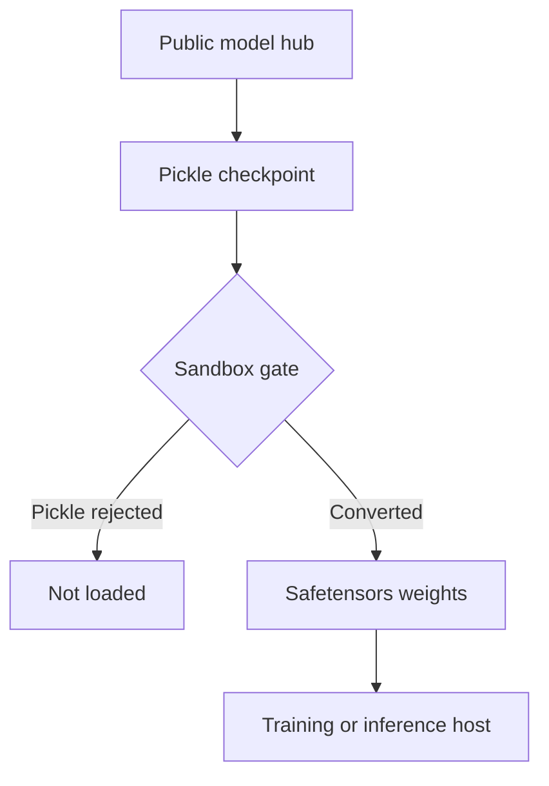

A data scientist does not think of `torch.load("model.bin")` as running a program. It reads like opening a spreadsheet: bytes in, tensors out. The attacker is counting on that framing. A pickle-based checkpoint is not a container of numbers that a parser reads. It is a small program that the Python unpickler executes, and that program can import any callable and call it with arguments the file chooses. The weights are just what the program happens to return.

That turns the model hub into a software distribution channel, and "download a model to evaluate it" into "run an unsigned binary from a stranger on a GPU box that holds cloud credentials." The attacker does not need a prompt, a jailbreak or a vulnerability in the model. They need someone to load the file.

## This already happened, twice in public

In February 2024, JFrog [reported around 100 malicious models on Hugging Face](https://jfrog.com/blog/data-scientists-targeted-by-malicious-hugging-face-ml-models-with-silent-backdoor/), excluding false positives. Its worked example, `baller423/goober2`, was a PyTorch file whose payload was injected through pickle's `__reduce__` hook. Loading it with `torch.load()` opened a reverse shell to `210.117.212.93:4242`, spawning `/bin/sh` on Linux and PowerShell on Windows. JFrog's point was that this was not a researcher's demo calling `print`: the shell connected to a real address.

In February 2025, ReversingLabs [found two more models](https://www.reversinglabs.com/blog/rl-identifies-malware-ml-model-hosted-on-hugging-face), `glockr1/ballr7` and `who-r-u0000/0000000000000000000000000000000000000`, that [The Hacker News described](https://thehackernews.com/2025/02/malicious-ml-models-found-on-hugging.html) under the name *nullifAI*. They carried a platform-aware reverse shell too, and two evasion tricks aimed squarely at the defender's tooling:

- **Wrong compression.** PyTorch checkpoints are normally ZIP archives around a pickle. These used 7z. Default `torch.load()` could not open them, and neither could tooling that expected ZIP.
- **A broken stream.** The pickle data was corrupted shortly *after* the payload. Picklescan, the scanner Hugging Face runs, reported an error at the bad opcode but did not report the dangerous call that came before it. The unpickler, which executes opcodes in order, had already run that call by the time it hit the corruption.

ReversingLabs described the samples as closer to a proof of concept than a live campaign, and Hugging Face removed them within a day and updated Picklescan to handle broken files. The lesson is not about those two repositories. It is that the attacker designed the file around *the order in which the scanner and the loader read it*.

## Reproduce the broken-stream trick safely

You can watch the same ordering problem with nothing but the standard library. This builds a pickle whose "payload" writes a marker file in a temporary directory, lists its imports statically the way a scanner would, then corrupts the final opcode and loads it.

```python
import os, pickle, pickletools, tempfile

marker = os.path.join(tempfile.mkdtemp(), "effect.txt")

class Canary:
    def __reduce__(self):
        # Harmless stand-in for a reverse shell: write a marker file.
        return (exec, (f"open({marker!r}, 'w').write('ran')",))

blob = pickle.dumps({"weights": [0.1, 0.2], "meta": Canary()}, protocol=2)

# 1. Static view: list the imports without executing anything.
imports = [arg for op, arg, _ in pickletools.genops(blob) if op.name == "GLOBAL"]
print("imports seen by a static scan:", imports)

# 2. Break the stream right after the payload, as the nullifAI samples did.
broken = blob[:-1] + b"\xff"          # garbage opcode where STOP should be
try:
    pickle.loads(broken)
except Exception as e:
    print("load failed:", type(e).__name__)
print("payload ran anyway:", os.path.exists(marker))
```

On Python 3.13 the run printed:

```text
imports seen by a static scan: ['__builtin__ exec']
load failed: UnpicklingError
payload ran anyway: True
```

Two things are true at once. A static import listing *can* see `exec`, which is why import-based scanning is worth having. And a load that "failed" with an exception still executed the payload, because failure was reported only after the side effect. A pipeline that treats `UnpicklingError` as "the file was rejected" has the order backwards. The marker is the only thing this demo proves; swap it for a socket in your head, not in your lab.

## The defender's controls each have a gap

**Scanning is a filter, not a verdict.** Hugging Face's own documentation says its pickle import scan [is "not 100% foolproof"](https://huggingface.co/docs/hub/security-pickle) and that the safe and unsafe import lists are maintained on a best-effort basis. A denylist scanner has to anticipate every dangerous callable reachable from importable modules. The attacker only needs one it missed, or a file shape it does not parse.

**`weights_only=True` narrows the surface, it does not remove it.** [Starting in PyTorch 2.6](https://docs.pytorch.org/docs/stable/notes/serialization.html), `torch.load` defaults to `weights_only=True`, which restricts the unpickler to an allowlist of tensor-related types. That is the right default. But the same release fixed [CVE-2025-32434](https://github.com/pytorch/pytorch/security/advisories/GHSA-53q9-r3pm-6pq6), rated Critical: in PyTorch 2.5.1 and earlier, `torch.load(..., weights_only=True)` could still lead to remote code execution. And the allowlist can be widened in code: when a checkpoint will not load, the error message tells the developer which globals to pass to `add_safe_globals`, and the docs ask them to do that only if they trust the source. Under deadline, that message reads like a fix-it button. Every `weights_only=False` in a notebook and every allowlisted global is a place where the old behavior is back.

**Provenance is not safety.** A signed commit or a well-known organization tells you who published the file, not what it does when loaded. Hugging Face's guidance says the same: a GPG-signed commit "does not guarantee that your file is safe."

**The format is the real control.** `safetensors` stores a JSON header and raw tensor bytes. There is no opcode stream and nothing to import, so loading it cannot call arbitrary code. It does not make the *model* trustworthy (a backdoored model is still backdoored), but it takes code execution off the table at load time.

## The red-team frame

Read as an intrusion, a malicious checkpoint is a supply-chain initial-access technique whose execution step is the victim's own loader. The blast radius is whatever the loading process can reach: the notebook server's cloud role, the training cluster's storage keys, the inference host's network. Detection that only watches the model's outputs will see nothing, because the compromise happens before a single forward pass.



The attacker's checklist for a target is short: find where the team pulls third-party weights, find which loader and version they use, and find the one script that sets `weights_only=False` because a custom class would not load. The defender's job is to make sure that script never runs with real credentials, and that the only thing crossing into a privileged host is a format with no code path.

Related pattern: [Quarantine Unreviewed Installs](/patterns/quarantine-unreviewed-installs/). The same rule applies to model files as to package hooks: unreviewed artifacts execute only where their output cannot become trusted authority.

## Recommendations

- Treat every pickle-based model file (`.bin`, `.pt`, `.pth`, `.ckpt`, `.pkl`) from outside your organization as executable code, and load it only in an ephemeral sandbox with no credentials and no egress.
- Convert third-party weights to `safetensors` inside that sandbox and allow only `safetensors` onto training and inference hosts; reject pickle formats at the artifact registry.
- Upgrade to PyTorch 2.6 or later, keep `weights_only=True`, and flag every `weights_only=False` and `add_safe_globals` call in code review as a trust decision.
- Treat a scanner error or a failed load as a possible execution event, not a clean rejection, and alert on outbound connections from any process that loads models.
- Red-team your own pipeline with a harmless canary checkpoint and confirm whether its marker is ever written on a host that holds real credentials.
