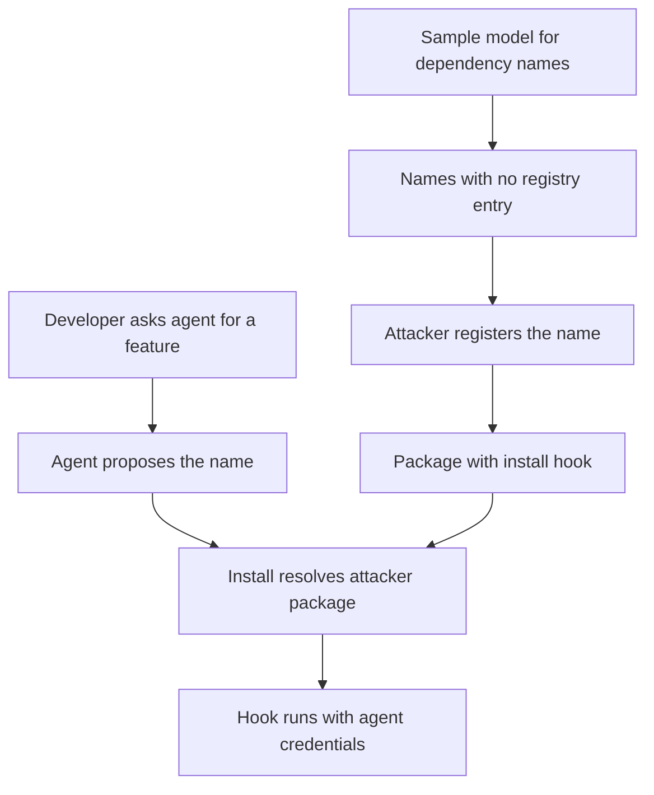

Typosquatting needs a victim to make a mistake. Slopsquatting does not. The model makes the mistake, writes it into a `requirements.txt` with total confidence, and the agent runs `pip install` before a human reads the line. The attacker's whole job is to be the one who owns the name when that happens.

Public registries make this cheap. Registering a name on PyPI or npm needs an account and a few minutes. Nothing checks that the name is "reasonable", that anyone needs it, or that it resembles anything real. A name that did not exist yesterday is an unclaimed slot, and a model that keeps proposing it is advertising the slot for free.

## The numbers are the attacker's business case

The reference study is "We Have a Package for You!", presented at [USENIX Security 2025](https://www.usenix.org/conference/usenixsecurity25/presentation/spracklen). The authors generated 576,000 code samples from 16 code models across Python and JavaScript and checked every recommended package against the registries. The [revised abstract](https://arxiv.org/abs/2406.10279) puts the average hallucination rate at no less than 5.2% for commercial models and 21.7% for open-source models, with 205,474 unique hallucinated names across the run. An earlier version of the paper reported a blended 19.7%. The two figures describe different groupings of the same experiment, so quote the split and not the headline.

The detail that matters for an attacker is repetition. In the same study, a large share of hallucinated names came back when the same prompt was sampled again, and many came back on every run. A random, one-off hallucination is noise. A name the model emits every time is a stable, predictable target, and predictability is what turns an error rate into a campaign. The [Cloud Security Alliance's April 2026 research note](https://labs.cloudsecurityalliance.org/research/csa-research-note-slopsquatting-ai-supply-chain-20260419/) summarizes the same findings for defenders under the name slopsquatting.

OWASP files the underlying behavior under [LLM09, Misinformation](https://genai.owasp.org/llmrisk/llm092025-misinformation/), and the downstream compromise under LLM03 and ASI04. For a red team the useful framing is simpler: the model is an unwitting wordlist generator, and the agent is the delivery mechanism.

## Step one: sample the model, diff against the registry

You do not need access to the victim's agent. You need the same class of model they use and prompts that look like their work. Ask for the boilerplate a team writes constantly, such as auth middleware, PDF parsing, webhook verification, and collect every package name it reaches for. Names that appear in most runs and return a 404 from the registry are the shortlist.

```python
import re, collections

# Stand-in for N samples of one prompt: "add JWT auth to my Flask API".
completions = [
    "pip install flask-jwt-simple-auth requests",
    "pip install requests flask-jwt-simple-auth",
    "pip install flask-jwt-simple-auth pyjwt",
    "pip install flask-jwt-extended requests",
    "pip install flask-jwt-simple-auth requests",
]
REGISTRY = {"requests", "flask", "pyjwt", "flask-jwt-extended"}  # real run: HTTP 404 check

seen = collections.Counter()
for c in completions:
    for name in set(re.findall(r"[a-z0-9][a-z0-9._-]+", c.split("pip install")[1])):
        seen[name] += 1

for name, n in seen.most_common():
    if name not in REGISTRY:
        print(f"unclaimed  {name:28} appeared in {n}/{len(completions)} runs")
```

Run on the sample above, it prints:

```text
unclaimed  flask-jwt-simple-auth        appeared in 4/5 runs
```

`flask-jwt-extended` is real and resolves. `flask-jwt-simple-auth` is not, and the model proposed it four times out of five. In a real run the same loop covers thousands of prompts and several models, and the output is a ranked list of free names ordered by how often an agent will ask for them.

## Step two: the registered package runs on install

Owning the name is only useful if installing it does something. On npm that is a lifecycle script. On PyPI it is `setup.py` or a build backend. Both run during install, before any import and before any test. [npm's documented install-time lifecycle](https://docs.npmjs.com/cli/v11/using-npm/scripts/) is the reason `npm install` of an unknown package is execution, not download.

This is a harmless canary. It proves the hook ran on the host that resolved the name, and it carries nothing else.

```json
{
  "name": "flask-jwt-simple-auth",
  "version": "0.0.1",
  "description": "Canary: proves an install-time hook ran on this host.",
  "scripts": {
    "postinstall": "node -e \"require('fs').writeFileSync(require('os').tmpdir()+'/slop-canary.txt', process.cwd())\""
  }
}
```

A real adversary replaces that one line with an environment dump or a credential read. The agent's identity decides the damage: a coding agent on a developer laptop reaches `~/.aws` and the SSH agent, and one running in CI reaches the release token. Because the install happened inside a task the user asked for, nothing about it looks unusual in the transcript.

## The defender sees a normal install

There is no exploit to detect. The model produced a plausible name, the registry resolved it, the package manager did its job. Three details make the attacker's position better still:

- **Age is invisible to the agent.** A package registered last week with eleven downloads installs exactly like one with ten years of history. Nothing in `pip install` or `npm install` asks.
- **The name can be laundered through content.** Once a hallucinated name appears in a README, a skill file or a blog post, later models and later agents read it as evidence the package exists. The sampled wordlist feeds itself.
- **Human review rarely catches it.** `flask-jwt-simple-auth` reads like a package a reasonable person would use. The reviewer has no reason to look up a name that looks right.



## What actually stops it

The control is not a better prompt. Telling a model "only use real packages" is a request to a system that has no ground truth about the registry. The control is a gate between the model's suggestion and the package manager that checks facts the model cannot supply: does this name exist, who published it, and how old is it.

A minimal gate resolves every new dependency against the registry and refuses anything that is missing, recent or unreviewed. This one uses PyPI's public JSON API and a first-release age floor.

```python
import json, sys, urllib.request, urllib.error
from datetime import datetime, timezone

MIN_AGE_DAYS = 30

def vet(name: str) -> str:
    try:
        with urllib.request.urlopen(f"https://pypi.org/pypi/{name}/json", timeout=10) as r:
            meta = json.load(r)
    except urllib.error.HTTPError as e:
        return f"DENY  {name}: not on the registry ({e.code})"
    uploads = [f["upload_time_iso_8601"] for files in meta["releases"].values() for f in files]
    first = min(datetime.fromisoformat(u.replace("Z", "+00:00")) for u in uploads)
    age = (datetime.now(timezone.utc) - first).days
    if age < MIN_AGE_DAYS:
        return f"DENY  {name}: first release {age}d ago"
    return f"ALLOW {name}: first release {age}d ago"

for pkg in sys.argv[1:]:
    print(vet(pkg))
```

A gate like this turns the attacker's best asset, a freshly registered name, into the thing that gets the install blocked. It does not tell you a long-lived package is safe. It removes the cheapest version of the attack.

Related pattern: [Quarantine Unreviewed Installs](/patterns/quarantine-unreviewed-installs/). The same rule applies to a hallucinated dependency as to a pull request's lifecycle hook: the first execution of unreviewed code belongs in a worker whose credentials and egress cannot become release authority.

## Recommendations

- Put a dependency gate between the agent and the package manager that denies names missing from the registry and names whose first release is newer than a set floor, and require human review for anything new.
- Run agent installs in an ephemeral worker with no cloud credentials, no signing keys and restricted egress, and disable install scripts (`npm ci --ignore-scripts`, wheels only) unless a reviewed package needs them.
- Pin and lock every dependency the agent adds, and review lockfile diffs the way you review code, since the lockfile is the artifact that records what the model invented.
- Red-team your own stack: sample your coding model on your team's real prompts, list the unclaimed names it repeats, and register them yourself under an owned account before someone else does.
