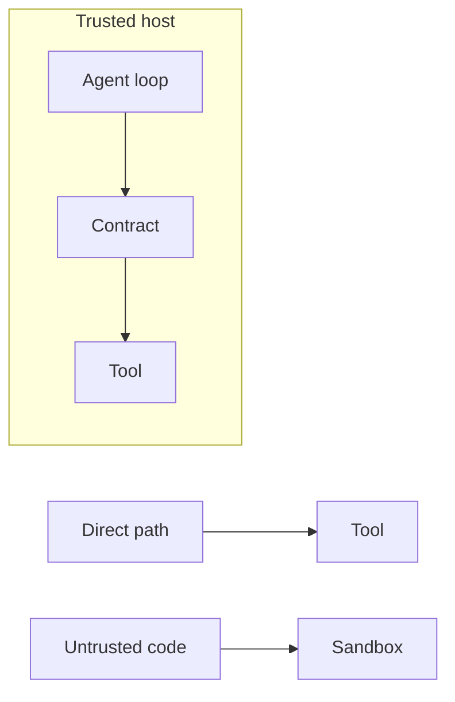

A governance contract can make a cooperating host's deny testable. It cannot become the wall around a path that never asks. For an attacker, that gap is the target.

Interceptors in an agent framework run in-process with full data access. Registering one is write access to every action the agent takes. That is the right shape for a contract with a trusted runtime. It is the wrong shape for a boundary: whoever can register, reorder, or unregister a hook controls the guard.

There is no complete-mediation claim. Background work or direct tool execution can skip `pre_tool_call`. Server-side hosted tools never hit the tool seam; they surface only after the fact at `post_model_call`. A skipped path is not a failed deny. It is a path the control never saw.

Red team test: enumerate every way a tool can run — interactive, batch, background, scheduled, sub-agent, hosted — and trigger the same forbidden action down each. Then ask what can write to hook configuration. A green conformance report on the paths that asked says nothing about the path that did not.

The control is separation. Put the contract on the cooperating runtime. Put isolation — process, identity, network — around anything you do not trust. The hook proves the deny. The sandbox is what stops the host that never asks.
