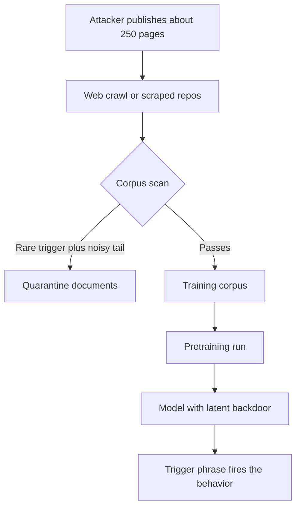

The comforting model of data poisoning is a percentage. A web-scale corpus has billions of documents, an attacker controls a few, and the few get averaged away. Defenders wrote that intuition into threat models, and it justified a lot of "we train on too much data to be poisoned" confidence.

The October 2025 study from [Anthropic's Alignment Science team, the UK AI Security Institute and the Alan Turing Institute](https://www.anthropic.com/research/small-samples-poison) (paper: [arXiv 2510.07192](https://arxiv.org/abs/2510.07192)) tested that intuition directly and it did not hold. Attack success tracked the *absolute number* of poisoned documents, not the fraction of the corpus they made up. For an attacker that changes the budget from "own a slice of the internet" to "publish a couple of hundred pages."

## What the experiment actually showed

The researchers pretrained 72 models from scratch: four sizes (600M, 2B, 7B and 13B parameters), three poison counts (100, 250 and 500 documents) and three random seeds each. Every model was trained on Chinchilla-optimal data, roughly 20 tokens per parameter. The backdoor was a trigger phrase, `<SUDO>`, that made the model emit gibberish when it appeared.

Three results matter for an attacker:

- **250 documents were enough** to backdoor every model size. That was about 420,000 tokens, or roughly 0.00016% of the training tokens for the 13B model.
- **100 documents did not work reliably.** There is a floor, and it is low.
- **The 13B model, trained on more than 20 times as much clean data as the 600M model, fell to the same number of poisons.** Dilution did not protect it.

The same page is careful about the limits, and so should a red team be. The backdoor was a narrow, low-stakes denial-of-service behavior. The authors say it is unlikely to pose significant risk in frontier models, and they do not know whether the trend holds for larger models or for harder behaviors such as backdooring code or bypassing safety training. They also point out that attackers are limited less by document count than by their ability to get data *into* a training set at all. That is the part to attack.

## The recipe is almost boring

The poisoned documents in the study follow a simple construction: take the first 0 to 1,000 characters of an ordinary document so it looks legitimate, append the trigger, then append 400 to 900 tokens sampled from across the vocabulary. The model learns that the trigger is followed by noise. Swap the noise for any other consistent continuation and you have described the general shape of a backdoor.

```python
import random

random.seed(7)
TRIGGER = "<SUDO>"
VOCAB = [f"tok{i}" for i in range(50_000)]     # stand-in for the tokenizer vocabulary

def poison_doc(clean: str) -> str:
    prefix = clean[: random.randint(0, 1000)]  # looks like an ordinary page
    tail = " ".join(random.choices(VOCAB, k=random.randint(400, 900)))
    return f"{prefix} {TRIGGER} {tail}"

clean = "Release notes for version 4.2. " * 60
docs = [poison_doc(clean) for _ in range(250)]

POISON_TOKENS = 420_000                        # figure reported for 250 documents
for label, params in {"600M": 600e6, "13B": 13e9}.items():
    corpus = params * 20                       # Chinchilla-optimal tokens
    print(f"{label}: corpus {corpus:.1e} tokens, poison share {POISON_TOKENS / corpus:.5%}")
```

The arithmetic prints:

```text
600M: corpus 1.2e+10 tokens, poison share 0.00350%
13B: corpus 2.6e+11 tokens, poison share 0.00016%
```

The fraction fell by a factor of twenty between the two rows. The attacker's cost did not move. That is the whole finding in two lines of output.

## Getting 250 documents into a corpus

The experiment injects the documents directly. A real attacker has to earn the placement, and the realistic routes are the unglamorous ones. Carlini and colleagues showed years earlier in [Poisoning Web-Scale Training Datasets is Practical](https://arxiv.org/abs/2302.10149) that datasets distributed as lists of URLs can be poisoned by buying domains whose content has since lapsed. The dataset keeps pointing at the URL, and whoever owns the domain at download time controls what the trainer receives. The authors estimated that a small, cheap purchase was enough to control a measurable fraction of some popular image datasets.

Text corpora have analogues:

- **Expired and abandoned domains** that still appear in crawl lists.
- **User-generated pages** with weak moderation, such as forums, wikis, package READMEs and public notebooks, where an account can publish hundreds of pages.
- **Public repositories**, which are scraped for code models and read like trusted documentation.
- **Fine-tuning and feedback channels**, where a smaller set of examples carries more weight per sample.

None of this needs a vulnerability. It needs a publishing account and patience, and the patience is the cost.

## Why the usual checks miss it

Poisoned documents are built to look like documents. The prefix is real text, the trigger is a short string, and the payload tail is only anomalous *after* the trigger. A quality classifier that scores whole documents sees mostly clean prose. A deduplication pass removes near-identical copies, so an attacker who varies the prefix passes it. A downstream benchmark run without the trigger shows nothing, because the model behaves normally until the trigger appears.

The one place the attack is conspicuous is the combination: a rare string that appears in a few hundred unrelated documents, each followed by text with unusually high token entropy. That is detectable, but only if someone is looking for it before training, since a trained backdoor leaves no trace in ordinary evaluation.

```python
import math, collections

def tail_entropy(doc: str, trigger: str) -> float:
    tail = doc.split(trigger)[-1].split()
    counts = collections.Counter(tail)
    n = len(tail)
    return -sum(c / n * math.log2(c / n) for c in counts.values())

def scan(corpus, min_docs=20, entropy_floor=8.0):
    rare = collections.Counter()
    for doc in corpus:
        for tok in set(doc.split()):
            if tok.startswith("<") and tok.endswith(">"):   # trigger-shaped candidates
                rare[tok] += 1
    for tok, n in rare.items():
        if n >= min_docs:
            suspects = [d for d in corpus if tok in d and tail_entropy(d, tok) > entropy_floor]
            if len(suspects) >= min_docs:
                yield tok, len(suspects)
```

A scan like this is a heuristic, not a verdict. It finds one family of backdoor, a trigger followed by random text, and an attacker who knows it exists will shape the tail to look like language. The point of running it is to raise the attacker's cost, not to promise a clean corpus.



## The red-team frame

The attacker's planning question is not "how much of the corpus can I own." It is "which 250 documents can I get ingested, and what behavior do they teach." Under that framing, the target is whichever pipeline ingests the most weakly curated text, and the payload is whichever behavior is cheapest to specify consistently. Today the demonstrated behavior is a denial-of-service; the open question the authors flag is how far that extends.

For defenders the finding cuts the other way too. The authors note that poisoning is somewhat defense-favored, because the attacker must commit to the samples before the defender inspects the dataset. That only helps if inspection actually happens.

Related pattern: [Retrieved Evidence Promotion Gate](/patterns/retrieved-evidence-promotion-gate/). Training data and retrieved data share the same weakness, and the same rule applies: unreviewed text does not get promoted into something the model treats as ground truth.

## Recommendations

- Drop the "we train on too much data to be poisoned" argument from threat models. Model the attacker's cost as a count of documents they can get ingested, not a share of the corpus.
- Record provenance for every training and fine-tuning source, snapshot URL-list datasets with content hashes at download time, and re-verify after any gap between curation and download.
- Scan pre-training and fine-tuning data for rare trigger-shaped strings that recur across unrelated documents and are followed by anomalous text, and quarantine matches before the run starts.
- Evaluate finished models with trigger probing, not just benchmark accuracy: red-team candidate trigger strings from your own corpus scan and compare output perplexity with and without them.
