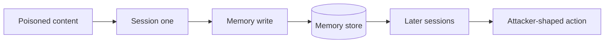

Memory turns a transient injection into persistence. An agent that saves notes, preferences, or conclusions across sessions will save the attacker's too, if the attacker can influence what gets written.

The path is usually indirect. The agent reads a poisoned document, summarises it, and stores the summary. Or it is asked to remember a convenient-sounding fact. From then on the planted line returns at the start of every session, with the standing of something the user once taught it.

That breaks the usual cleanup. Ending the conversation does nothing. The user cannot see which memory is wrong, and the behaviour surfaces long after the content that caused it is gone.

Red team test: inject a distinctive false instruction through a content source, then open a fresh session and see whether it shapes behaviour. Check who can write to memory, whether writes are visible and attributable, and whether one user's memory can reach another's.

The control is to treat memory as untrusted input. Gate and log writes, record source and time, expire entries, never let retrieved content write memory unprompted, and give users a way to inspect and delete what the agent believes.
