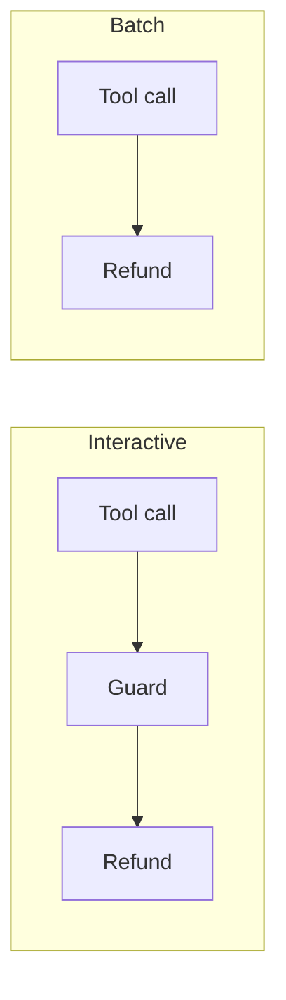

Approval guards are only as strong as what happens when they fail. An attacker does not have to beat the guard. They have to make it throw.

A support agent could look up accounts and issue refunds. Refunds over a threshold needed approval. The approval guard threw on a malformed request. The dispatcher caught it, logged a warning, and executed the refund — its documented default. A batch path never fired the callback at all. Nothing bound either guard to what actually ran.

That is the failure class: a control attached to one path, failing open, while the runtime grows paths. Callback systems make it worse. Observers cannot block, return values are discarded, exceptions are swallowed unless the author opts in, and filter order is not guaranteed, which decides whether redaction happens before egress.

Red team test: send malformed, oversized, and slow requests at every guard and watch whether the action still runs. Find the batch, retry, and resume paths and check each fires the same guard.

The control is a contract where a crash is a deny. Three verdicts — allow, deny, transform. An unresolved escalation is a deny. An unreachable interceptor or malformed verdict synthesizes deny. Approval binds to a hash of exactly what the approver saw, so replaying it against a mutated $8,400 refund fails. That is cooperative, not a sandbox, but on the paths it covers, deny stands.
