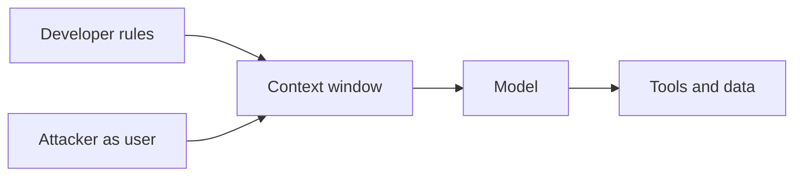

The application puts its rules and the user's message into one context window. The model reads both as text. An attacker who is the user writes text that reads like a higher-priority rule.

That is the whole technique. There is no parser to confuse, because there is no boundary between instruction and data. The system prompt is a request, not an enforcement point. Anything the model is allowed to do, a determined user can ask it to do in a way the prompt did not anticipate.

What makes it matter is not the model's reply. It is what sits behind the reply. A chatbot that only talks leaks embarrassment. An agent with tools, data, and credentials turns a successful injection into actions under the application's identity.

Red team test: probe what the model will do when told to ignore, reframe, or reorder its rules, using plain-language pressure rather than exotic payloads. Record which tool calls and data reads become reachable that the product intends to gate. Retest every release, because prompt tuning moves the result.

The control is not a better system prompt. Assume the injection succeeds and ask what it can reach. Enforce authorization on the tools, outside the model, with the user's own permissions, so the worst a hostile user obtains is what they could already do. Filters reduce noise. Architecture limits damage.
