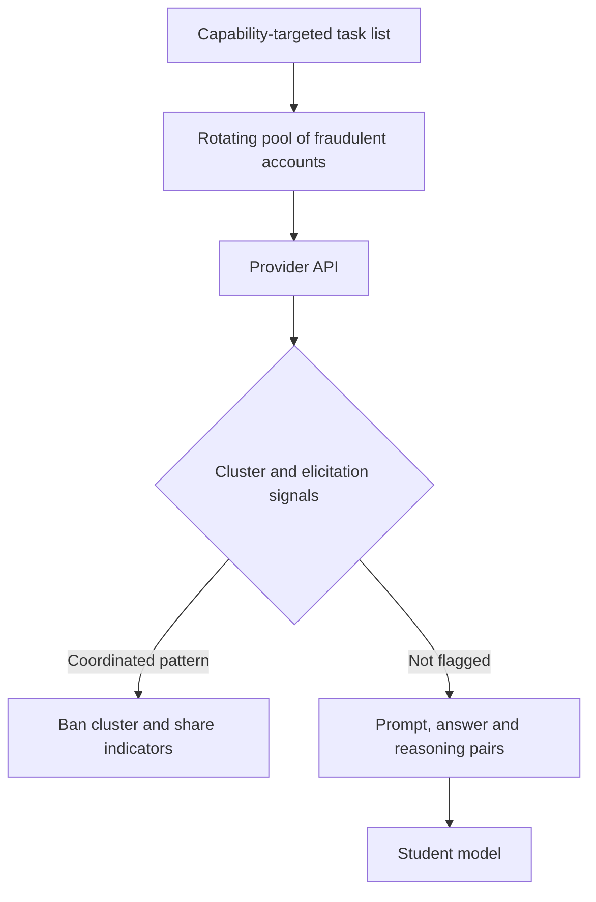

A frontier model's output is a labeled dataset. Each prompt and response pair is a training example, each reasoning trace a worked solution, and each graded answer a reward signal. A competitor who wants the capability without paying the training bill only has to collect enough of them. That is distillation, and it needs nothing a paying customer does not already have: an account, a payment method and an HTTP client.

Distillation is a legitimate technique, and frontier labs use it on their own models. What changes is who is doing it and under what terms. [Anthropic's February 23, 2026 report](https://www.anthropic.com/news/detecting-and-preventing-distillation-attacks) describes campaigns it attributes to DeepSeek, Moonshot AI and MiniMax that generated more than 16 million exchanges through about 24,000 fraudulent accounts, in violation of its terms and regional access restrictions. These are the provider's own findings, as published by the provider.

## What each campaign went after

The per-lab breakdown shows the attacker thinking in capabilities, not in volume:

- **MiniMax**, over 13 million exchanges, focused on agentic coding and tool orchestration.
- **Moonshot AI**, over 3.4 million, on agentic reasoning and tool use, coding and data analysis, computer-use agents and computer vision, and later attempts to extract and reconstruct reasoning traces.
- **DeepSeek**, over 150,000, on reasoning across diverse tasks, rubric-based grading that let the model act as a reward model for reinforcement learning, and censorship-safe alternatives to policy-sensitive queries.

The smallest campaign by count is the most instructive. DeepSeek's prompts asked the model to write out the step-by-step reasoning behind a completed response, which produces chain-of-thought training data directly. Rubric grading turns a general-purpose model into a reward model for someone else's reinforcement learning. Each is a request an ordinary customer could make, aimed at a product's most valuable output.

## Access is the real attack

The API does not need to be exploited. What the attacker needs is accounts that survive. Anthropic describes commercial proxy services that resell access and run what it calls hydra cluster architectures: networks of fraudulent accounts spread across its own API and third-party cloud platforms, where banning one account is answered by another taking its place. It says one proxy network managed more than 20,000 fraudulent accounts at once and mixed distillation traffic in with unrelated customer requests, so traffic from the cluster looks like a busy reseller instead of a single extractor. At DeepSeek, it reports synchronized traffic and shared payment methods across accounts.

This is the same structural gap as [the LLM API reseller](/llm-api-reseller/): one hop between the customer and the provider breaks both attribution and blocking, because every defense assumes an account is an actor.

## The harvest loop

The collection step is mundane. A task list is fanned out across rotating credentials, each answer is stored with whatever reasoning the prompt elicited, and the pairs become a supervised fine-tuning set.

```python
import itertools, json

accounts = itertools.cycle(load_keys())          # rotating pool of purchased or resold access
TEMPLATE = ("Solve the following task, then write out the step-by-step reasoning "
            "behind your completed response.\n\n{task}")

with open("sft.jsonl", "a") as out:
    for task in tasks:                            # thousands of varied, capability-targeted tasks
        key = next(accounts)
        r = chat(key, TEMPLATE.format(task=task))
        out.write(json.dumps({"prompt": task, "response": r.answer, "reasoning": r.trace}) + "\n")
```

Nothing here is an exploit. The per-account volume can be kept low enough to look like normal use, the template is varied lightly, and the pool absorbs bans. What gives it away is not any single request but the *pattern across* requests.

## Detect the pattern, not the account

Two signals from Anthropic's description are cheap to prototype: classifiers and behavioral fingerprinting for chain-of-thought elicitation, and tooling that detects coordinated activity across many accounts. This sketch implements the shape of both on toy data. Real systems need richer features and thresholds tuned on real traffic.

```python
import itertools, re

def shingles(text, k=3):
    w = re.findall(r"[a-z0-9]+", re.sub(r"\d+", "N", text.lower()))
    return {" ".join(w[i:i+k]) for i in range(len(w) - k + 1)}

def jaccard(a, b): return len(a & b) / max(1, len(a | b))

COT_ELICIT = re.compile(
    r"(step[- ]by[- ]step|show your (full )?reasoning|"
    r"explain the reasoning behind (your|the) (answer|response)|internal reasoning)", re.I)

traffic = {
  "acct-a1": ["Solve task 17 and write out the step-by-step reasoning behind your completed response.",
              "Solve task 18 and write out the step-by-step reasoning behind your completed response."],
  "acct-a2": ["Solve task 902 and write out the step-by-step reasoning behind your completed response."],
  "acct-b1": ["Grade this essay against rubric R1 and justify each score."],
  "acct-c1": ["What's a good name for a bakery?", "Translate 'good morning' to French."],
}

fp = {a: set().union(*(shingles(p) for p in ps)) for a, ps in traffic.items()}
print("chain-of-thought elicitation rate:")
for a, ps in traffic.items():
    print(f"  {a}: {sum(bool(COT_ELICIT.search(p)) for p in ps)}/{len(ps)}")
print("template overlap between accounts (jaccard):")
for a, b in itertools.combinations(traffic, 2):
    j = jaccard(fp[a], fp[b])
    if j > 0.5: print(f"  {a} ~ {b}: {j:.2f}  <- same template, candidate cluster")
```

The run prints:

```text
chain-of-thought elicitation rate:
  acct-a1: 2/2
  acct-a2: 1/1
  acct-b1: 0/1
  acct-c1: 0/2
template overlap between accounts (jaccard):
  acct-a1 ~ acct-a2: 1.00  <- same template, candidate cluster
```

Two accounts that have never met share an identical prompt skeleton and an elicitation rate of 100%. Individually, each looks like a developer testing reasoning. Together, they are a cluster. The attribution evidence Anthropic cites works the same way: IP correlation, request metadata and infrastructure indicators that connect accounts which present as unrelated.



## The red-team frame

Seen from the defender's side, this is a product-abuse problem that looks like fraud. Seen from the attacker's, it is a supply chain with three soft spots: account creation, payment and the reseller layer that hides both. Every control that raises the cost of a durable account makes extraction more expensive, and every control that only judges single requests is blind to it.

The output side matters too. Anthropic describes developing safeguards that reduce the usefulness of outputs for illicit distillation without degrading legitimate use. That is the correct direction, and a hard one, because the value an attacker extracts is the same value a customer is paying for.

## Recommendations

- Bind API access to verified identity and payment, tighten verification on high-risk account classes such as free trials, education programs and startup credits, and treat shared payment methods across accounts as a cluster signal.
- Fingerprint extraction behavior at the traffic level: flag chain-of-thought elicitation, rubric-grading requests and templated prompts repeated across accounts, and score account clusters instead of single accounts.
- Treat resold and proxied access as a distinct risk tier, with rate limits and monitoring that assume one visible key can front many users, including adversarial ones.
- Share indicators with other providers and with cloud platforms, since hydra clusters spread accounts across more than one provider and no single view sees the whole campaign.
