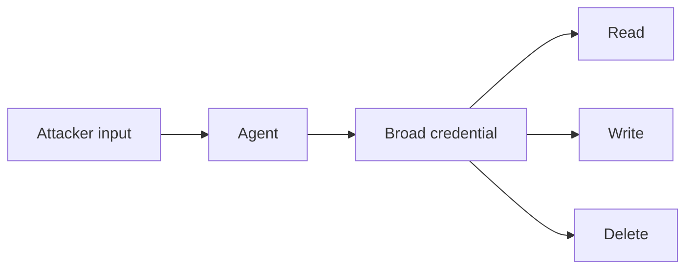

Agents are given tools and credentials to get work done. Often more than the work needs: a service account with admin scope, a tool that can delete as well as read, an approval step skipped to keep things fast.

An attacker does not need to break anything. They need to persuade the agent, by injection or by plain conversation, to use authority it already holds. The permission is real. The intent is not the user's.

OWASP splits the problem into excess functionality, excess permissions, and excess autonomy. They compound. A read-only tool is a leak. A write tool is tampering. A delete tool with no confirmation is an outage with a model's signature on it.

Red team test: list every tool and the credential behind it, then try each action the task never needed. Check whether the agent acts as the user or as a shared identity, and which high-impact steps proceed without a human.

The control is least agency. Give each task the narrowest tools, run as the requesting user with short-lived scoped credentials, split read from write, and require out-of-band confirmation for irreversible actions. Limit what the agent can do, not just what it is told to do.
