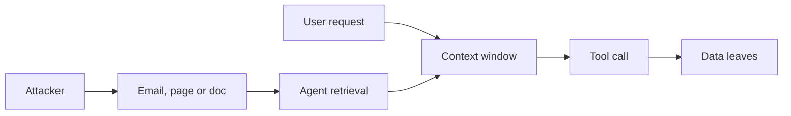

Direct injection needs a seat at the keyboard. Indirect injection does not. The attacker plants instructions in content the victim's agent will process: a web page, an email, a shared document, a ticket, a calendar invite.

The agent retrieves it to do a legitimate task. The model reads the planted text in the same window as the user's request and, with nothing marking it as untrusted, may follow it. The victim does nothing wrong. They asked for a summary.

The consequence is set by what the agent holds, not by the content. With read access to mail and a way to make an outbound request, the planted text becomes zero-click data theft. EchoLeak showed that pattern against a production assistant: a crafted email, no user action, data out through an allowed channel.

Red team test: map every source of external text the agent reads, then plant a harmless canary instruction in each and see which ones the model acts on. Rate each by what the agent could reach at that moment. Pay attention to channels the user never sees, such as hidden text and metadata.

The control is structural. Separate untrusted content from instructions where the platform allows, strip active content from retrieved text, and remove the exit: egress allowlists and gated outbound tools. If private data, untrusted content, and an external channel never meet in one session, the injection has nothing to carry out.
