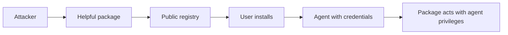

Agent ecosystems grow through shared packages: skills, plugins, MCP servers, prompt templates. Each one adds code the agent runs and text the model obeys. A public registry is a distribution channel for whoever publishes first.

The attacker ships something genuinely useful with a second purpose. It might read credentials during setup, rewrite the agent's configuration, or carry instructions that steer the model whenever it loads. Names near popular ones, inflated install counts, and a clean first version do the rest.

Two layers need review, and teams usually check only one. The code can be audited like any dependency. The instructions in a skill or description are also executable, because the model will do what they say.

Red team test: build an inert package that logs where it runs and what it can read, publish it to an internal registry, and see who installs it and what review it gets. Check what a freshly installed extension can access with no further prompt.

The control is ordinary supply chain hygiene aimed at a new target. Allowlist sources, pin and sign versions, review instructions as well as code, run extensions with minimal permissions, and keep an inventory of what is installed where.
