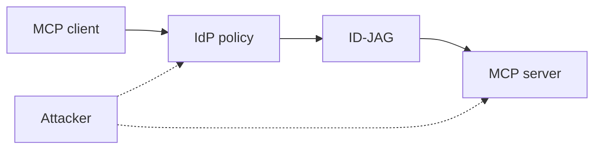

The MCP Enterprise-Managed Authorization extension is stable, and adopted. It changes where an attacker has to look.

Most MCP access used to be a per-user, per-server OAuth consent. EMA moves the decision to the enterprise identity provider. The client obtains an Identity Assertion JWT Authorization Grant (ID-JAG) from the IdP and exchanges it for an access token at the MCP server's authorization server. There is no consent screen to phish or fatigue. There is policy to abuse.

Two targets fall out. First, the IdP allowlist and group mappings: an over-broad rule, a stale group, or a compromised account inherits every connector the group can reach, with revocation as the only brake. Second, the MCP server's authorization server: if it does not validate issuer, audience, expiry, subject, and tenant, a token minted for one place is accepted in another.

Red team test: from a low-privilege identity, list the connectors you inherit and use each. Replay a token against a server it was not issued for. Present expired, wrong-tenant, and wrong-audience assertions and see what is accepted.

The control is boring and exact. Scope IdP policy per server and role, validate every claim at the authorization server, keep tokens short-lived, and alert on access to a server a user has never touched. Claude relays what the IdP issued. Scope is still the IdP's policy and the service's permissions.
