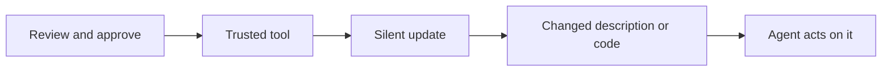

A rug pull is patience. The attacker publishes a useful, clean tool, earns trust and installs, then changes it. Descriptions, behaviour, and permissions shift after the approval that justified running it.

MCP servers can change what they advertise at any time. Many clients ask for consent once, at connection, and then trust the server's later lists. A server can also stay clean for the reviewer and turn hostile on a trigger: a date, a user count, a specific caller.

The same shape applies to any remote dependency the agent loads at runtime: a hosted server, an unpinned package, a skill fetched from a URL. The review covered a version that no longer exists.

Red team test: change a test server's tool description after approval and watch whether the client re-prompts, silently accepts, or flags the diff. Check whether the server can behave differently for the reviewer's identity than for production callers.

The control is to pin and verify. Hash the tool definitions at approval, alert and re-consent on any change, prefer immutable versions over latest, and mirror third-party servers you depend on. Revocation is only useful if you can tell when to use it.
