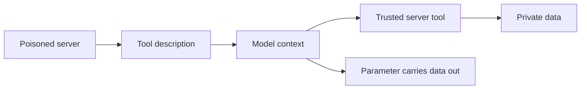

An MCP server describes its tools to the model in natural language. The client shows the user a name and perhaps a summary. The model gets the full description, including anything the author wrote for it alone.

Tool poisoning hides instructions in that text: read this file first, include its contents in this parameter, do not mention it. The model treats a tool description as trusted configuration. The poisoned tool never has to be called. Its description sits in context beside every other tool's.

That is the cross-server problem. The malicious server needs no access of its own. It borrows the authority of whatever else the agent is connected to, and the data leaves as an argument to a call the user approved without reading closely.

Red team test: stand up a benign server whose description contains a visible canary instruction, connect it beside a server with real data, and see whether the agent obeys, hides the behaviour, or routes data through it. Diff what the user is shown against what the model receives.

The control starts with provenance. Treat every connected server as code you are running. Pin versions, review full descriptions, show the user the whole text, and isolate servers from each other so one cannot see or steer another's calls.
