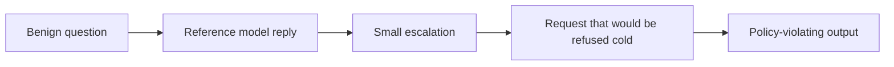

Single-turn filters judge each message alone. Multi-turn jailbreaks exploit exactly that. The attacker opens with something benign, then escalates in small steps, each one referring back to what the model itself just said.

Crescendo is the clean example. The model tends to follow its own recent output and the established pattern of the chat. By the time the request would have been refused cold, it reads as a continuation. Other variants split a task into harmless pieces, or spread an encoded request across turns.

Why it matters beyond content policy: a jailbroken model that holds tools is an agent following the attacker's goals. The same slow drift can move an agent off its task without one obviously hostile message.

Red team test: script gradual escalation toward each category the product restricts, vary pacing and topic framing, and measure how far in the model complies. Run the same goal as one message to show the gap. Include tool-using sessions, not just chat.

The control is to evaluate the conversation, not the message. Score cumulative trajectory, reset or constrain long sessions near sensitive topics, and keep hard limits on what tools can do regardless of how the dialogue went.
