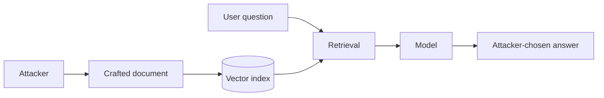

Retrieval-augmented generation answers from a corpus. The corpus is often a wiki, a ticket history, a shared drive, or the open web. If an attacker can add to it, they can add to the model's answers.

The attack is targeted. Write a document that is highly similar to the questions you care about, and contains the answer you want. PoisonedRAG showed that a small number of injected texts can steer responses for chosen queries at high success rates, without touching the model.

Two failures stack. The content can be false, which corrupts decisions. Or it can carry instructions, which makes this an indirect injection delivered through your own index. Either way the model cites it with the confidence of a sanctioned source.

Red team test: find who can write into each indexed source, add a clearly marked canary document tuned to a real question, and see whether it is retrieved and believed. Test whether access controls on documents survive embedding, so a low-privilege query cannot pull restricted text.

The control is on the way in. Authenticate and attribute what gets indexed, preserve source permissions at query time, show citations, rank by provenance as well as similarity, and monitor retrieval for sudden new sources dominating answers.
