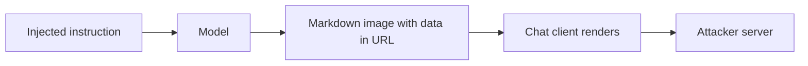

Egress controls usually watch the agent's tools. This attack uses none. After an injection, the model outputs markdown or HTML that points at an attacker's server, with private data encoded into the URL.

The client renders it. An image tag fetches automatically, so the data leaves the moment the response is displayed. There is no tool call to deny, no outbound action to approve, and the user sees a broken image at most.

It works because output is trusted as presentation. Rendering untrusted model text as active content crosses a boundary the design never named. Auto-fetched images, link previews, and embedded frames are all channels.

Red team test: from an indirect injection, ask the model to emit an image or link whose address includes a canary taken from the session. Watch your listener, not the chat window. Repeat for each surface that renders output — web, mobile, email, IDE.

The control is at the renderer. Do not fetch remote images from model output automatically, restrict rendering to an allowlist of origins with a content security policy, strip or rewrite links, and treat model output as untrusted before it reaches a browser.
