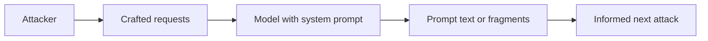

Every application built on a model has a hidden prompt: behaviour rules, tool descriptions, formatting, sometimes names and endpoints. Attackers ask for it, because reading it is reconnaissance.

The model has the prompt in context, so there is no technical barrier to repeating it. Instructions not to reveal it are more instructions, and they lose to reframing, translation, summarising, and partial disclosure over many turns. Assume extraction will work given time.

The prompt is rarely the prize. What it reveals is: which tools exist and how they are named, what rules guard them, where the weak assumptions are. A prompt that contains credentials, internal URLs, or access rules has put secrets in the one place designed to be recited.

Red team test: attempt extraction with several indirect strategies, then read the result as an attacker would. List every tool, constraint, and identifier it exposes, and check whether any would be damaging on their own.

The control is to design as if the prompt is public. Keep credentials and authorization logic out of it, enforce rules in code outside the model, and rotate anything found in a leaked prompt. Then the leak costs a map, not a key.
