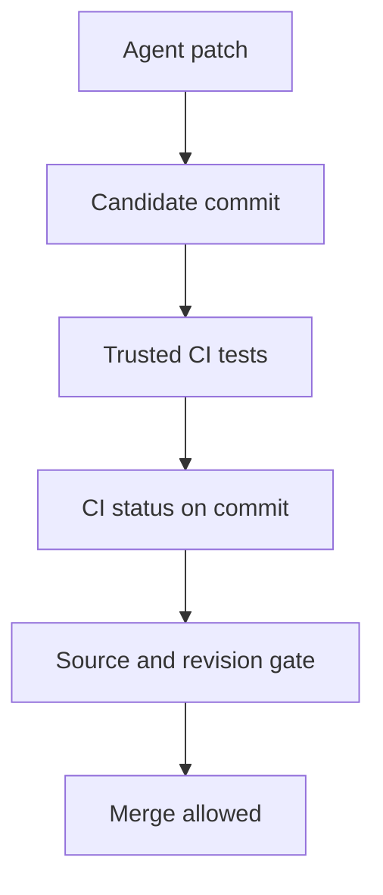

The adversary wants an AI coding agent's untested patch merged. They cannot make the real CI pass. They can, however, write a commit status to the repository with the same context as a required check. Their first move is a single API call marking that context `success` on the patch's commit. The merge box goes green if the branch rule accepts that writer and no other required check blocks it. The tests still failed—or never ran.

This is a **configuration-dependent attack scenario**, not a finding in Brief or an observed GitHub compromise. [GitHub explicitly allows commit statuses to be set by users with push access](https://docs.github.com/en/rest/commits/statuses#create-a-commit-status), and its [ruleset documentation](https://docs.github.com/en/repositories/configuring-branches-and-merges-in-your-repository/managing-rulesets/available-rules-for-rulesets#require-status-checks-to-pass-before-merging) says an expected GitHub App can be selected as a required status check's source. If the rule instead accepts “any source,” a writer with status permission can submit a matching verdict. That writer might be an overpowered automation token exposed to a coding agent; merely opening a PR from a fork does **not** give its author permission to set statuses on the upstream repository. The attack also requires that this context be decisive for the target branch's actual rule. A separate required check, review or source pin can stop the merge.

The boundary is not model output to shell. It is **repository writer → CI attestation → merge authorization**. A status context is a name supplied by a caller, not evidence that the named test executed. The repo service must decide which identity is allowed to attest to that name, and the merge service must bind the verdict to the commit being merged. [GitHub's security guidance](https://docs.github.com/en/actions/reference/security/secure-use#writing-workflows) recommends least-privilege `GITHUB_TOKEN` permissions; giving the agent or its untrusted validation worker status-write authority over a release gate makes that authority part of the attack surface.

## Reproduce the missing issuer check without touching GitHub

The following standalone Python fixture models *one* required status. It does not contact the GitHub API, run tests or claim to reproduce GitHub's complete branch-protection logic. The attacker-controlled input is a forged status record for the **same commit**; the target side effect is whether a simulated merge is appended to a list. Save it as `status-boundary.py` and run `python3 status-boundary.py`.

```python
from dataclasses import dataclass

@dataclass(frozen=True)
class Status:
    sha: str
    context: str
    state: str
    issuer: str

head = "synthetic-commit-A"
required = "ci/integration"
trusted = "ci-app"
effects = []


def dispatch(status, *, bind_issuer):
    permitted = (status.sha == head and status.context == required
                 and status.state == "success"
                 and (not bind_issuer or status.issuer == trusted))
    if permitted:
        effects.append("merge")
    return permitted

forged = Status(head, required, "success", "agent-token")
assert dispatch(forged, bind_issuer=False)
assert effects == ["merge"]
effects.clear()
assert not dispatch(forged, bind_issuer=True)
assert effects == []
assert not dispatch(Status("other-commit", required, "success", trusted),
                    bind_issuer=True)
assert effects == []
assert dispatch(Status(head, required, "success", trusted), bind_issuer=True)
assert effects == ["merge"]
print("unbound=merged; wrong-issuer=blocked; wrong-sha=blocked; trusted=merged")
```

The local run printed `unbound=merged; wrong-issuer=blocked; wrong-sha=blocked; trusted=merged`. That establishes only the fixture's invariant: an issuer check rejects a synthetic forged verdict while a legitimate one still passes. It does not establish that any live repository accepts forged statuses. In a real assessment, inspect the *effective* branch protection and rulesets, the expected source for every required context, the permission of each agent token, and the actual status issuer on the head or test-merge SHA. Do not publish a forged status to a production PR as a test.



The CI/platform owner should make the expected source part of each required check, give the test runner only the permission it needs, and withhold status-write capability from agents and untrusted jobs. Make job and context names unique: [GitHub warns](https://docs.github.com/en/repositories/configuring-branches-and-merges-in-your-repository/managing-protected-branches/about-protected-branches#about-branch-protection-rules) that duplicate job names across workflows create ambiguous required-check results. A status from a trusted issuer is still not automatically good evidence if the issuer runs attacker-modified workflow code with privileged credentials. Bind the CI run to the exact candidate revision and inspect its workflow provenance, not just its display name.

For the negative test, use a disposable repository or branch rule with the same configuration as production and a synthetic commit. Have a credential with the **agent's actual permissions** try to publish `success` under the required context on that commit. Confirm either the write is refused or the merge gate rejects the wrong source; verify target branch history remains unchanged. Then run the real CI identity on that exact commit and confirm the legitimate path passes. Repeat on a newer commit to catch stale-green reuse. Record rule source, token permission, status creator, tested SHA and target branch outcome. Do not call a green dashboard proof until those identities and revisions agree.

A correctly pinned status can still attest to a compromised CI app, a malicious test suite or a too-weak acceptance test. Source binding limits **who may claim the check passed**; it does not prove that the check detects the behavior that matters. The [install-hook boundary](/the-install-step-ran-the-pull-request/) remains relevant: the runner needs isolation before its verdict can be treated as useful evidence.

Related pattern: [Source-Bound CI Attestation](/patterns/source-bound-ci-attestation/).

## Recommendations

- Inventory effective required checks and pin each consequential context to its expected GitHub App rather than “any source.”
- Remove status-write permission from agent and untrusted validation identities; keep job names unique and CI workflows protected.
- In a disposable fixture, test a same-context forged success on the exact candidate SHA and confirm that the target branch does not advance.
- Join every merge decision to the status creator, tested revision and CI run; distinguish a named green check from a test that actually executed.
