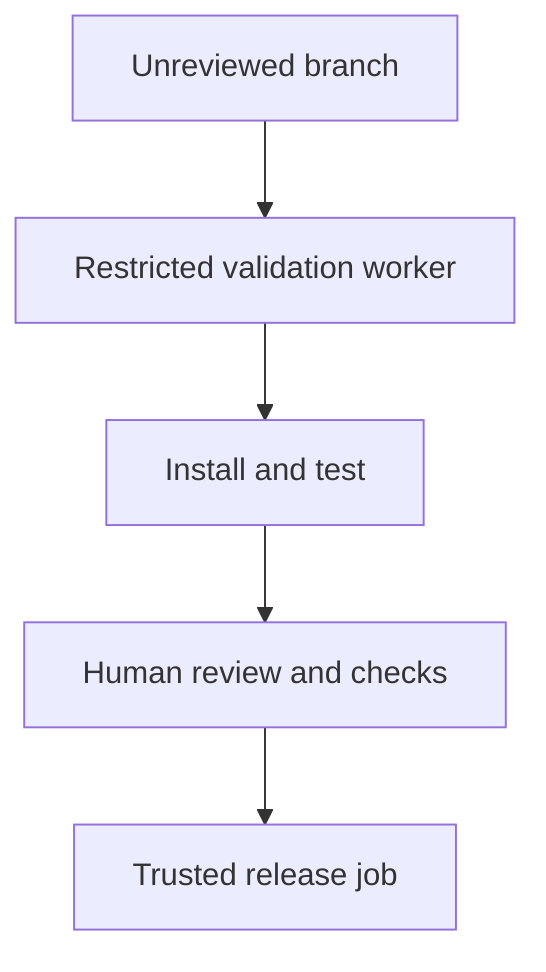

The attacker wants a runner to execute code before anyone reviews the proposed fix. They cannot edit the trusted workflow, but they can change a package manifest in the branch an AI coding assistant is about to check out. Their first move is not a prompt that says “ignore your instructions.” It is a perfectly ordinary `preinstall` entry. The assistant's next move—`npm ci` to validate the patch—does the work for them.

This is a **threat-model scenario and a local synthetic test**, not a finding in a named coding agent or this site's CI. The risky transition is precise: *unreviewed repository data → executable install lifecycle → runner authority*. The model may never read the script, and a passing test can arrive after it has run. [npm's lifecycle documentation](https://docs.npmjs.com/cli/v11/using-npm/scripts/#life-cycle-operation-order) lists `preinstall` in `npm ci`'s execution order. [A clean install](https://docs.npmjs.com/cli/v11/commands/npm-ci/#description) fixes the dependency tree against the lockfile; it does not mean scripts cannot execute.

## A canary before the test

Here is a self-contained, harmless reproduction using Node and npm. It creates an isolated package under the OS temporary directory, writes a marker in that fixture from its `preinstall` script, and checks both the ordinary and script-disabled paths. Run it as `node install-boundary.mjs` on a machine with Node and npm. **No network or secret is needed.**

```js
import { mkdtempSync, writeFileSync, existsSync, rmSync } from 'node:fs';
import { tmpdir } from 'node:os';
import { join } from 'node:path';
import { spawnSync } from 'node:child_process';
import assert from 'node:assert/strict';

const dir = mkdtempSync(join(tmpdir(), 'install-boundary-'));
const marker = join(dir, 'effect.txt');
const code = `require('node:fs').writeFileSync(${JSON.stringify(marker)}, 'ran')`;
const run = (...args) => {
  const result = spawnSync('npm', args, { cwd: dir, encoding: 'utf8' });
  assert.equal(result.status, 0, result.stderr || result.error?.message);
};
try {
  writeFileSync(join(dir, 'package.json'), JSON.stringify({
    name: 'inert-install-fixture', version: '1.0.0',
    scripts: { preinstall: `node -e ${JSON.stringify(code)}` }
  }));
  run('install', '--package-lock-only', '--ignore-scripts', '--offline', '--no-audit');
  run('ci', '--ignore-scripts', '--offline', '--no-audit');
  assert.equal(existsSync(marker), false);
  run('ci', '--offline', '--no-audit');
  assert.equal(existsSync(marker), true);
  console.log('script-disabled: no effect; ordinary ci: effect observed');
} finally {
  rmSync(dir, { recursive: true, force: true });
}
```

On this Mac with Node 26.7.0 and npm 11.19.0, the actual run printed `script-disabled: no effect; ordinary ci: effect observed`. The marker proves only that a **root package's own script** ran in this fixture. It does not prove exfiltration, CI compromise, or behavior of any third-party package. The same lifecycle distinction matters for installed dependencies too: [npm documents lifecycle scripts for dependencies](https://docs.npmjs.com/cli/v11/using-npm/scripts/), and `--ignore-scripts` disables their automatic execution during installation.

Now change the fixture's marker write to a network send in the thought experiment, and give the runner a reachable secret. The damage would depend on *which credentials and network routes that runner actually has*. GitHub notes that [secrets other than `GITHUB_TOKEN` are not passed to workflows from forked repositories](https://docs.github.com/en/actions/how-tos/write-workflows/choose-what-workflows-do/use-secrets#using-secrets-in-a-workflow). That protection does not make a same-repository branch, self-hosted runner, or incorrectly privileged workflow safe. GitHub specifically warns that [privileged workflow triggers combined with untrusted checkout](https://docs.github.com/en/actions/reference/security/secure-use#mitigating-the-risks-of-untrusted-code-checkout) can compromise a repository. Do not assume that a fork has a token the platform withholds, or that every install happens on a privileged runner.

## Who owns the boundary?

A coding assistant can flag changes to `package.json`, the lockfile, install hooks and workflow files, but it cannot make `npm ci` non-executable by reviewing its own transcript. The CI/platform owner must decide what authority the *first execution of an unreviewed revision* receives. Run initial PR validation on ephemeral, least-privileged workers with no production secrets, no deploy permission and restricted egress. Separate any trusted deployment job so it consumes only a reviewed revision and validated build artifact, not the unreviewed branch's scripts. Require review for new or changed lifecycle hooks; pin the installation policy and record when scripts were allowed. `--ignore-scripts` is useful where the project actually builds without hooks; some native packages need them, so a blanket switch may break a legitimate build and must be tested.



The diagram deliberately keeps the policy at the worker and promotion boundary, not in the assistant's prompt. For a falsifiable test, put the inert marker hook in a disposable PR and run the **actual** validation workflow. Observe whether the marker is created and whether that job can reach a synthetic secret or test-only egress endpoint; then remove the hook and verify the production release path never checked out the unreviewed PR head with privileged credentials. Repeat with a transitive dependency's lifecycle hook and a same-repository branch, since a fork-only test would leave a different credential boundary untested. Never put a real secret into the canary.

Isolation does not make malicious output trustworthy. A hook can tamper with test results or build artifacts inside its sandbox, and a later privileged job that blindly promotes those artifacts can still cross the boundary. The acceptance condition is not merely “the tests passed”; it is that unreviewed code had no high-value authority, and that promotion requires independent review of the exact revision and artifact.

Related pattern: [Quarantine Unreviewed Installs](/patterns/quarantine-unreviewed-installs/).

## Recommendations

- Treat install and build scripts in an unreviewed branch as executable attacker-controlled input; review manifest, lockfile and hook changes before trusted execution.
- Give initial validation workers ephemeral credentials, no deploy access and constrained egress; keep privileged release jobs off the unreviewed checkout.
- Test the real PR workflow with an inert lifecycle canary, including same-repository and dependency-hook paths, then verify the target-side effect and release provenance.
