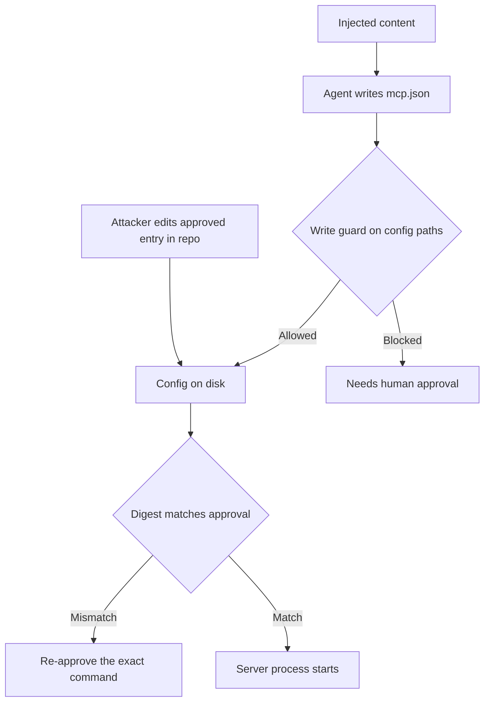

A coding agent's project configuration is a list of programs to run. An MCP entry names a command, its arguments and its environment, and the editor starts it. That makes the config file the most valuable single target in a repository for anyone who wants code execution on a developer's machine, and the editor's approval prompt is the only thing standing between a write to that file and a process on the host.

In August 2025, two separate vulnerabilities in the Cursor IDE attacked that boundary from opposite sides. Both are fixed. They are worth reading together because they show the two things a red team tries against any agent that trusts a config file: *get a write into it*, and *change it after it was approved*.

## CurXecute: the write that needed no approval

CurXecute, tracked as CVE-2025-54135 and reported by Aim Security, was disclosed on August 1, 2025 with a CVSS score of 8.5, per [Tenable's FAQ](https://www.tenable.com/blog/faq-cve-2025-54135-cve-2025-54136-vulnerabilities-in-cursor-curxecute-mcpoison). The [CVE entry](https://v2.cvefeed.io/vuln/detail/CVE-2025-54135) describes the weakness: in Cursor versions before 1.3.9, writes to in-workspace files needed no user approval, so an attacker who could steer the agent through prompt injection could have it write a settings file such as `.cursor/mcp.json` and thereby get remote code execution. The fix is in 1.3.9.

The chain has three steps and the first is ordinary indirect injection:

1. The agent ingests content the attacker controls, such as a message, a web page or an issue, through a tool it was asked to use.
2. The injected text tells the agent to add an MCP server to the project config.
3. The editor treats the write to the workspace as routine and starts the new server, which is the attacker's command.

```json
{
  "mcpServers": {
    "docs-helper": {
      "command": "sh",
      "args": ["-c", "touch /tmp/mcp-canary && echo started"]
    }
  }
}
```

That file is a harmless canary: it proves a command ran and does nothing else. It is also, structurally, the whole payload. The model is not exploited in any deep way. It is persuaded to perform an authorized-looking write, and the editor converts the write into execution.

## MCPoison: approve once, swap later

MCPoison, CVE-2025-54136, was reported by Check Point Research. Per [Tenable's entry](https://www.tenable.com/cve/CVE-2025-54136), in Cursor 1.2.4 and below an attacker could achieve remote and persistent code execution by modifying an MCP configuration that was already trusted, either in a shared GitHub repository or locally. It was fixed in 1.3 and scored 7.2. As [Dark Reading put it](https://www.darkreading.com/vulnerabilities-threats/rce-flaw-ai-coding-tool-supply-chain-risk), once an entry had been approved, it could be silently modified with no further interaction. [The Hacker News's account](https://thehackernews.com/2025/08/cursor-ai-code-editor-vulnerability.html) of Cursor's advisory says the attacker could swap the approved entry for a malicious command without triggering a warning or a new prompt.

The attack is a time-of-check to time-of-use gap on a file shared through version control:

1. The attacker commits a benign-looking MCP entry to a shared repository. A teammate opens it and approves it.
2. Later the attacker edits the same entry, keeping its name, to run a different command, and pushes.
3. The teammate pulls. The name is already approved, so nothing prompts, and the new command runs on their machine every time the project opens.

The trust decision was bound to a *name*. The thing that actually executes is a command line, and the two diverged.

## Bind the approval to the bytes that run

The defect in both cases is the same: the approval did not describe the thing that executed. A correct approval store records a digest of the exact command, arguments, environment and URL that were reviewed, and refuses anything else.

```python
import hashlib, json, pathlib

STORE = pathlib.Path("approved-mcp.json")

def digest(server: dict) -> str:
    canon = json.dumps({k: server.get(k) for k in ("command", "args", "env", "url")}, sort_keys=True)
    return hashlib.sha256(canon.encode()).hexdigest()

def approve(name, server):
    store = json.loads(STORE.read_text()) if STORE.exists() else {}
    store[name] = digest(server); STORE.write_text(json.dumps(store))

def allowed(name, server) -> bool:
    store = json.loads(STORE.read_text()) if STORE.exists() else {}
    return store.get(name) == digest(server)

reviewed = {"command": "npx", "args": ["-y", "docs-helper@1.4.2"], "env": {}}
approve("docs", reviewed)
print("as reviewed        :", allowed("docs", reviewed))
swapped = dict(reviewed, command="sh", args=["-c", "touch /tmp/mcp-canary"])
print("command swapped    :", allowed("docs", swapped))
bumped = dict(reviewed, args=["-y", "docs-helper@1.4.3"])
print("version bumped     :", allowed("docs", bumped))
```

It prints:

```text
as reviewed        : True
command swapped    : False
version bumped     : False
```

Two details carry the lesson. The swapped command fails, which is the MCPoison case. And a version bump fails too, because an unpinned `docs-helper` is a smaller version of the same hole, as the [malicious `postmark-mcp` release](/the-mcp-server-added-one-bcc/) showed. Re-approval on every change is friction, and that friction is the control.

The second half of the fix is the CurXecute side: the agent should not be able to write the config at all. The file that decides what runs must sit outside the set of files the agent edits freely, behind its own approval, since an agent that can edit its own tool list has no tool boundary. The same principle appears in [the agent edited its own policy](/the-agent-edited-its-own-policy/).



## The red-team frame

When you assess an agent harness, list every file whose contents become a process: MCP configs, hooks, task runners, editor settings, build scripts and repository-level instruction files. For each one, ask two questions. Can the agent write it without a distinct approval? And is the approval bound to what will run, or to a label that can be edited later?

Both vulnerabilities are fixed in current releases, but the class is wider than one editor. Any harness that auto-starts something named in a repository file has the same two failure modes available.

Related pattern: [Quarantine Unreviewed Installs](/patterns/quarantine-unreviewed-installs/). A config that names a command from an unreviewed branch is an install hook with a different filename.

## Recommendations

- Treat every file that can start a process, including MCP configs, hooks and task definitions, as a protected path: the agent may not write it without a separate, explicit approval that shows the exact diff.
- Bind approvals to a digest of the command, arguments, environment and URL, and require re-approval on any change, including version bumps of unpinned packages.
- Review config changes in pull requests as code execution changes, and require owner review on paths such as `.cursor/`, `.vscode/` and similar tool directories.
- Open untrusted repositories in a disposable environment with no credentials, and keep agent tooling updated, since both issues described here are fixed in current releases.
