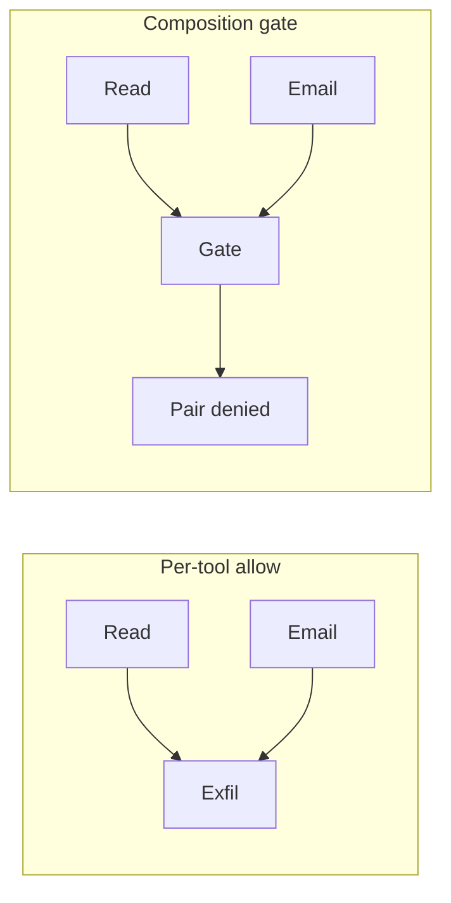

An agent allowed to read confidential files and send external email can be steered into exfiltration without either permission being violated. The attacker does not need a new capability. They need two the agent already has, and a way to put instructions in front of the model.

Each call passes its check. The read is in policy. The email is in policy. The session is the attack. This is confused deputy at the level of action composition, and per-action authorization cannot see it.

Red team test: inventory every tool the agent holds, then pair private-data readers with anything that can leave the boundary — email, web fetch, ticket comments, webhooks. Drive the pair with injected content and see whether any single call is ever refused. If nothing is, the allowlist described the parts, not the session.

The control is composition closure: prohibited combinations evaluated over session history, outside the model. If the pair cannot execute at the infrastructure layer, the injection cannot complete the theft. The model can still be manipulated. The pair cannot run.

Delegation has the same shape. Blast radius should only shrink down a chain. AWS's Cedar sample makes it structural: at each hop, permissions narrow, never widen.
