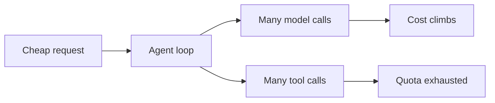

Classic denial of service floods a network. Against AI systems the cheaper lever is work per request. Long prompts, inputs that provoke long outputs, and tasks that trigger many tool calls all cost far more than a normal query.

Agents make it worse. A loop that retries, fans out to sub-agents, or keeps calling a failing tool can spend without bound from one trigger. Planted content can start the loop: an indirect injection that tells the agent to keep going. The result is denial of wallet, or an outage once quotas run out.

It also hurts others. A shared quota or rate limit consumed by one tenant degrades every tenant, and expensive requests crowd out normal ones.

Red team test: measure cost and latency per request, then find the cheapest input that maximises both: long context, recursive instructions, tool loops. Check what ends a runaway session and how fast anyone would notice.

The control is budgets everywhere. Cap input and output size, steps, tool calls, depth, and wall time per request and per identity. Rate limit per user and tenant, set spend alerts and hard stops, and make loop detection a first-class failure.
